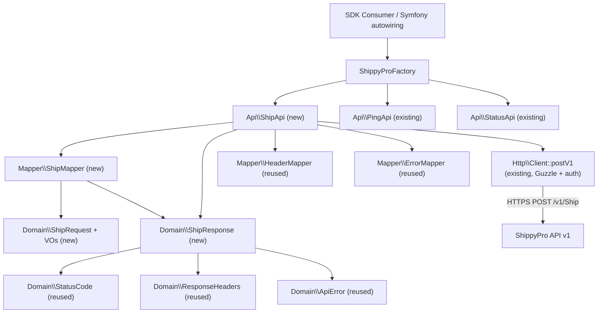
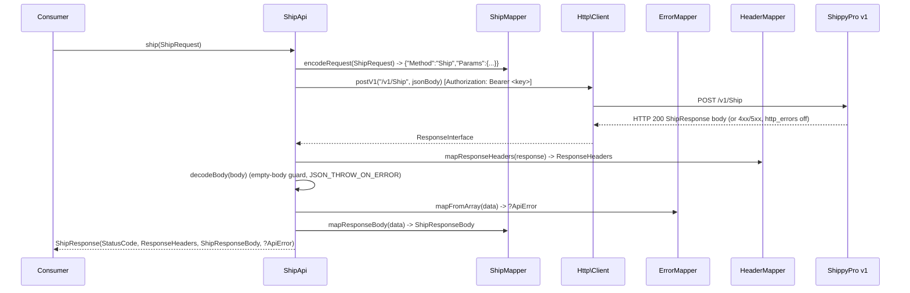

# Design Document

## Overview

This document describes the technical design for adding the **`POST /v1/Ship`** endpoint to the existing, already-implemented **ShippyPro SDK (PHP)** (namespace `DjThossi\ShippyProSdk\`). The SDK is a typed, object-oriented library that already exposes `POST /v1/Ping` and `GET /v2/status`. The Ship endpoint is added as a new slice that reuses the existing transport, header, error and status infrastructure and follows the exact conventions of the current code.

The authoritative request/response schema is the OpenAPI document #[[file:v1.json]] in the project root. It is the single source of truth for field names, types, enums, `required` constraints and `security`. The `Ship` method request parameters are modeled by the `ShipParams` schema and the response by the `ShipResponse` schema. Content derived from that document has been rephrased for compliance with licensing restrictions.

### Design Goals

- **Reuse, do not duplicate.** The new slice adds only `Api\ShipApi` and `Mapper\ShipMapper` plus the Ship domain/VO/exception types. Transport (`Http\Client::postV1`), header mapping (`HeaderMapper`), error normalization (`ErrorMapper`), `StatusCode`, `ApiError`, `ResponseHeaders` and `MissingRequiredFieldsException` are reused unchanged (Requirements 1.4, 1.5, 10.1–10.3, 11.4).
- **Everything is an object.** The public API of `ShipApi::ship()` accepts a typed `ShipRequest` and returns a typed `ShipResponse`. Arrays appear only inside `ShipMapper`, at the (de)serialization boundary (Requirement 11).
- **Consistency with the existing endpoints.** `ShipApi` mirrors the `PingApi`/`StatusApi` decode/guard/map pattern precisely: empty-body guard, `json_decode(..., true, 512, JSON_THROW_ON_ERROR)`, map headers, map a possible `ApiError`, and surface documented HTTP error codes through `StatusCode` without throwing (Requirement 10).
- **Correct, typed customs modeling.** The CUSTOMS/CN22 block is the primary focus and is modeled as typed objects with correct enums, so cross-border declarations are not assembled as error-prone raw structures (Requirement 6).
- **Normalize the polymorphic label field.** `LabelURL` is polymorphic in #[[file:v1.json]] (empty array on error, a single string, or an array of strings) and is normalized into one typed collection (Requirement 9.4–9.6).

### Key Design Decisions and Rationale

| Decision | Rationale |
| --- | --- |
| Reuse `Http\Client::postV1`, no new transport method | The Ship request is a Bearer-authenticated v1 envelope POST, identical in transport shape to Ping. A new transport method would duplicate auth logic and violate the "no Ship-specific logic in the client" rule (Requirements 1.5, 11.4). |
| `ShipApi` follows the exact `PingApi` decode/guard/error pattern | Keeps error-surfacing behavior consistent across endpoints: documented HTTP codes (`400/401/403/404/429/500`) are observed via `StatusCode`, never thrown, and body errors are normalized by the shared `ErrorMapper` (Requirements 10.1–10.3). |
| Validate exactly the three documented customs invariants at `ShipRequest` build time | Requirement 12 confirms only the `EXW`↔`BillAccountNumber` pair and the Cross-Border↔`TotalValue` rules are enforced client-side; carrier/country matrices stay the API's responsibility, giving fast local failure without over-constraining. |
| Generic `CarrierOption` plus named helper constants | Valid option names are only authoritatively known at runtime via `GetCarrierOptions`; a strict per-carrier enum would be wrong by construction. Helpers add typed convenience without blocking arbitrary names (Requirements 7, 13). |
| Single `CN22Item`/`Cn22ItemCollection`, no CN23 type | #[[file:v1.json]] defines only `CN22Info[]`; there is no distinct CN23 structure. The same container carries low-value (CN22) and higher-value (CN23/CP71) line items; the carrier decides the physical form (Requirements 6.11, 6.12). |
| `LabelUrlCollection` normalizes the polymorphic `LabelURL` | The schema's `oneOf` (string | string[]) plus the empty-array error case is collapsed into one ordered typed collection so callers never branch on the raw JSON shape (Requirements 9.4–9.6). |
| Label dimensions in centimetres only, no inches helper | #[[file:v1.json]] defines `LabelWidth`/`LabelHeight` in cm; an inches convenience type would invite unit confusion. A 4x8 inch label is documented as ~`10.16` x `20.32` cm (Requirement 17.2, 17.3). |

## Architecture

The Ship slice preserves the existing layering: transport, orchestration and (de)serialization remain strictly separated (Requirement 11). The new `ShipApi` and `ShipMapper` plug into the existing shared components.



### Request / Response Flow — `POST /v1/Ship`



### Directory Layout

New files only; existing files are untouched except `ShippyProFactory` (gains `createShipApi()`) and the `examples/`/`Makefile` additions.

```
shippy-pro-sdk/
├── examples/
│   └── ship.php                          (new, Requirement 15)
├── src/
│   ├── Api/
│   │   └── ShipApi.php                    (new, Requirement 1)
│   ├── Domain/
│   │   ├── Address.php                    (new, Requirement 2)
│   │   ├── CountryCode.php                (new, ISO 3166-1 alpha-2 VO, Requirement 2.3)
│   │   ├── Parcel.php                     (new, Requirement 3)
│   │   ├── ParcelCollection.php           (new, Requirement 3.6)
│   │   ├── ParcelAttributes.php           (new, Requirement 3.5, 6.9)
│   │   ├── DimensionUnit.php              (new enum, Requirement 3.2)
│   │   ├── WeightUnit.php                 (new enum, Requirement 3.3)
│   │   ├── MoneyAmount.php                (new, TotalValue VO, Requirement 4.1, 4.2)
│   │   ├── Insurance.php                  (new, Requirement 4.3)
│   │   ├── CashOnDelivery.php             (new, Requirement 4.4)
│   │   ├── CashOnDeliveryType.php         (new enum, Requirement 4.5)
│   │   ├── Customs.php                    (new, Requirement 6.1)
│   │   ├── Incoterm.php                   (new enum, Requirement 6.2)
│   │   ├── CustomInfoContentsType.php     (new enum, Requirement 6.4)
│   │   ├── NonDeliveryOption.php          (new enum, Requirement 6.8)
│   │   ├── Cn22Item.php                   (new, Requirement 6.5)
│   │   ├── Cn22ItemCollection.php             (new, Requirement 6.7)
│   │   ├── CarrierOption.php              (new, Requirement 7.1)
│   │   ├── CarrierOptionCollection.php    (new, Requirement 7.2)
│   │   ├── CarrierOptionName.php          (new, named helper constants, Requirement 7.3)
│   │   ├── LabelType.php                  (new enum, Requirement 17.1)
│   │   ├── LabelFormatting.php            (new, Requirement 17)
│   │   ├── ShipRequest.php                (new, Requirement 2, 12)
│   │   ├── ShipResponse.php               (new, Requirement 9)
│   │   ├── ShipResponseBody.php           (new, Requirement 9.1)
│   │   ├── ShipStatus.php                 (new enum, Requirement 9.2)
│   │   ├── LabelUrlCollection.php         (new, Requirement 9.4–9.6)
│   │   ├── ErrorType.php                  (new, Requirement 9.8)
│   │   ├── ErrorSuggestion.php            (new, Requirement 9.8)
│   │   ├── ShipParcel.php                 (new, Requirement 9.9)
│   │   └── ShipParcelCollection.php       (new, Requirement 9.9)
│   ├── Exception/
│   │   ├── InvalidCountryCodeException.php (new, Requirement 2.4)
│   │   ├── InvalidMoneyAmountException.php (new, Requirement 4.2)
│   │   └── InvalidCustomsException.php     (new, Requirement 12.1–12.3)
│   ├── Mapper/
│   │   └── ShipMapper.php                 (new, Requirement 1, 9)
│   └── ShippyProFactory.php               (edited: + createShipApi())
├── tests/
│   ├── Unit/                              (new Ship tests, Requirement 16)
│   └── Integration/
└── Makefile                              (edited: + examples-ship target)
```

## Components and Interfaces

All signatures follow the existing style: `final readonly` value/domain objects, `readonly` Api/Mapper classes, constructor promotion, `declare(strict_types=1)` in every file.

### `Api\ShipApi` (Requirement 1)

Orchestrates `POST /v1/Ship` with the same decode/guard/map flow as `StatusApi`/`PingApi`. It holds no request-construction domain logic — the body is built entirely by `ShipMapper` (Requirement 1.2) — and sends through the existing `Http\Client::postV1` (Requirement 1.5).

```php
namespace DjThossi\ShippyProSdk\Api;

readonly class ShipApi
{
    private const string ENDPOINT = '/v1/Ship';

    public function __construct(
        private Client $client,
        private ShipMapper $mapper,
        private HeaderMapper $headerMapper,
        private ErrorMapper $errorMapper,
    ) {
    }

    public function ship(ShipRequest $request): ShipResponse;

    /** @return array<string, mixed> */
    private function decodeBody(string $body): array; // empty-body guard + JSON_THROW_ON_ERROR
}
```

Behavior (mirrors `StatusApi::status()`):
- Encodes the request via `$this->mapper->encodeRequest($request)` → `{"Method":"Ship","Params":{...}}` (Requirement 1.1).
- Calls `$this->client->postV1(self::ENDPOINT, $jsonBody)`.
- Wraps `$response->getStatusCode()` in a `StatusCode`; maps headers via `HeaderMapper` (Requirement 10.3).
- Decodes the body with the empty-body guard and `json_decode($body, true, 512, JSON_THROW_ON_ERROR)`.
- Maps a possible transport/envelope error via `ErrorMapper::mapFromArray()` (Requirement 10.2). On a non-OK status or a present `ApiError`, returns `new ShipResponse($statusCode, $headers, null, $error)` — the body is not mapped for non-success responses, exactly as `StatusApi` does.
- Otherwise maps the body via `ShipMapper::mapResponseBody()` and returns `new ShipResponse($statusCode, $headers, $body)` (Requirement 1.3).

> Note: unlike Ping (whose `Result` is optional and tolerant), the business-level failure of a successful HTTP 200 Ship is still fully readable from the mapped `ShipResponseBody` (`Status === ShipStatus::Error`, `ErrorMessage`, `ErrorType`, `ErrorSuggestion`) alongside the `StatusCode` (Requirements 9.2, 10.5). A 200 body is always mapped.

### `Mapper\ShipMapper` (Requirements 1, 9, 11.1)

The only class allowed to read/write arrays for the Ship request and response.

```php
namespace DjThossi\ShippyProSdk\Mapper;

final readonly class ShipMapper
{
    public const string METHOD = 'Ship';
    public const string FIELD_METHOD = 'Method';
    public const string FIELD_PARAMS = 'Params';

    // ShipParams request field names (exact v1.json names).
    public const string FIELD_TO_ADDRESS = 'to_address';
    public const string FIELD_FROM_ADDRESS = 'from_address';
    public const string FIELD_PARCELS = 'parcels';
    public const string FIELD_TRANSACTION_ID = 'TransactionID';
    public const string FIELD_CONTENT_DESCRIPTION = 'ContentDescription';
    public const string FIELD_CARRIER_NAME = 'CarrierName';
    public const string FIELD_CARRIER_SERVICE = 'CarrierService';
    public const string FIELD_CARRIER_ID = 'CarrierID';
    // ... RateID, OrderID, TotalValue, Insurance(+Currency),
    //     CashOnDelivery(+Currency,+Type), Note, CarrierNote, UserNote,
    //     PaymentMethod, Incoterm, BillAccountNumber, CustomInfoContentsType,
    //     CarrierOptions, CN22Info, non_delivery_option, IsReturn,
    //     ReturnCarrierName/Service/ID, ReturnInsurance(+Currency),
    //     ReturnCarrierOptions, return_to, Attributes,
    //     LabelType, LabelWidth, LabelHeight, Rotate, PageNumber, SplitPages.

    // ShipResponse field names (exact v1.json names).
    public const string FIELD_RESULT = 'Result';
    public const string FIELD_NEW_ORDER_ID = 'NewOrderID';
    public const string FIELD_LABEL_URL = 'LabelURL';
    public const string FIELD_PDF = 'PDF';
    public const string FIELD_ZPL = 'ZPL';
    public const string FIELD_TRACKING_CARRIER = 'TrackingCarrier';
    public const string FIELD_TRACKING_NUMBER = 'TrackingNumber';
    public const string FIELD_TRACKING_EXTERNAL_LINK = 'TrackingExternalLink';
    public const string FIELD_ADDITIONAL_TRACKING_NUMBERS = 'AdditionalTrackingNumbers';
    public const string FIELD_DELIVERY_CARRIER = 'DeliveryCarrier';
    public const string FIELD_STATUS = 'Status';
    public const string FIELD_ERROR_MESSAGE = 'ErrorMessage';
    public const string FIELD_RETURN_ERROR_MESSAGE = 'ReturnErrorMessage';
    public const string FIELD_ERROR_TYPE = 'ErrorType';
    public const string FIELD_ERROR_SUGGESTION = 'ErrorSuggestion';
    public const string FIELD_PARCELS_OUT = 'Parcels';
    public const string FIELD_RETURN_PARCELS = 'ReturnParcels';

    // Response body required fields guarded with MissingRequiredFieldsException.
    public const array REQUIRED_FIELDS = [self::FIELD_RESULT, self::FIELD_STATUS];

    public function encodeRequest(ShipRequest $request): string;      // -> envelope JSON

    /** @return array<string, mixed> the ShipParams array (no envelope) */
    public function encodeParams(ShipRequest $request): array;        // request serialization

    /** @param array<string, mixed> $data */
    public function mapResponseBody(array $data): ShipResponseBody;   // decode + required-field guard

    /** @param array<string, mixed> $data */
    public function mapLabelUrl(array $data): LabelUrlCollection;     // polymorphic normalization
}
```

Request encoding (Requirement 1.1, 5.3, 17.7): `encodeParams()` builds the `ShipParams` array using the exact field names above, **omitting** every optional member that is not provided (Requirement 17.7). `encodeRequest()` wraps it as `json_encode([FIELD_METHOD => METHOD, FIELD_PARAMS => $params], JSON_THROW_ON_ERROR)`, matching `PingMapper::encodeRequest()`. When `$params` could be empty it is cast to `(object)` so it serializes as `{}` (same technique `PingMapper` uses for `Params`).

Response mapping (Requirement 9): `mapResponseBody()` first guards `REQUIRED_FIELDS` and throws `MissingRequiredFieldsException` naming the missing fields (Requirement 10.4), reusing the `StatusMapper::ensureRequiredFields` pattern. It then maps every field into the typed `ShipResponseBody`, normalizing `LabelURL` via `mapLabelUrl()` (Requirements 9.4–9.6) and nesting `ErrorType`/`ErrorSuggestion`/`Parcels`/`ReturnParcels` into their typed objects/collections (Requirements 9.8, 9.9).

### `ShippyProFactory` (Requirement 1.4)

Gains one method, wired exactly like `createPingApi()` (reusing the existing private `createClient()`, `createHeaderMapper()`, `createErrorMapper()`):

```php
public function createShipApi(): ShipApi
{
    return new ShipApi(
        $this->createClient(),
        $this->createShipMapper(),
        $this->createHeaderMapper(),
        $this->createErrorMapper(),
    );
}

private function createShipMapper(): ShipMapper
{
    return new ShipMapper();
}
```

## Data Models

All Value Objects are `final readonly` with validation in the constructor, mirroring the existing `ApiKey`/`BaseUrl` style. All public accessors expose only typed objects or scalars — never associative arrays (Requirement 11.2, 11.3).

### Request base model

#### `ShipRequest` (models `ShipParams`; Requirements 2, 5, 12)

```php
final readonly class ShipRequest
{
    public function __construct(
        public Address $toAddress,
        public Address $fromAddress,
        public ParcelCollection $parcels,
        public string $transactionId,
        public string $contentDescription,
        public string $carrierName,
        public string $carrierService,
        public int $carrierId,
        public ?string $rateId = null,
        public ?string $orderId = null,
        public ?MoneyAmount $totalValue = null,
        public ?Insurance $insurance = null,
        public ?CashOnDelivery $cashOnDelivery = null,
        public ?string $note = null,
        public ?string $carrierNote = null,
        public ?string $userNote = null,
        public ?string $paymentMethod = null,
        public ?Customs $customs = null,
        public ?CarrierOptionCollection $carrierOptions = null,
        public ?bool $isReturn = null,
        public ?string $returnCarrierName = null,
        public ?string $returnCarrierService = null,
        public ?int $returnCarrierId = null,
        public ?Insurance $returnInsurance = null,
        public ?CarrierOptionCollection $returnCarrierOptions = null,
        public ?Address $returnTo = null,
        public ?LabelFormatting $labelFormatting = null,
        public ?ParcelAttributes $attributes = null,   // order-level, incl. sp_ioss (Req 6.9)
    ) {
        // Requirement 12 — the only client-side invariants:
        $this->assertIncotermBillAccountConsistency();
        $this->assertCrossBorderHasTotalValue();
    }

    public function isCrossBorder(): bool;  // fromAddress.country != toAddress.country
}
```

`Insurance` carries both amount and currency; `ReturnInsurance`/`ReturnInsuranceCurrency` reuse the `Insurance` VO for the return leg (Requirements 4.3, 8.1, 8.5). The default `EUR` currency is applied inside `Insurance` when an amount is supplied without a currency.

#### `Address` + `CountryCode` (Requirement 2.2–2.4)

```php
final readonly class Address
{
    public function __construct(
        public string $name,
        public string $company,
        public string $street1,
        public string $street2,
        public string $city,
        public string $state,
        public string $zip,
        public CountryCode $country,
        public string $phone,
        public string $email,
    ) {
    }
}

final readonly class CountryCode
{
    public string $value; // normalized upper-case alpha-2

    public function __construct(string $value); // throws InvalidCountryCodeException if not /^[A-Za-z]{2}$/
}
```

`country` is modeled as the `CountryCode` VO so the ISO 3166-1 alpha-2 rule lives in one place; an invalid code throws `InvalidCountryCodeException` (Requirement 2.4).

### Parcels (Requirement 3)

```php
final readonly class Parcel
{
    public function __construct(
        public float $length,
        public float $width,
        public float $height,
        public float $weight,
        public DimensionUnit $dimensionUnit = DimensionUnit::Cm,   // Req 3.2 default CM
        public WeightUnit $weightUnit = WeightUnit::Kg,            // Req 3.3 default KG
        public ?int $package = null,                              // Req 3.4 carrier package id
        public ?ParcelAttributes $attributes = null,             // Req 3.5
    ) {
    }
}

final readonly class ParcelCollection
{
    /** @param Parcel[] $parcels */
    public function __construct(array $parcels);   // typed; no raw array exposed (Req 3.6)

    /** @return Parcel[] */
    public function all(): array;
    public function isEmpty(): bool;
}

final readonly class ParcelAttributes
{
    public function __construct(
        public ?string $parcelId = null,
        public ?string $parcelType = null,
        public ?string $spIoss = null,   // managed `sp_ioss` IOSS attribute (Req 6.9)
    ) {
    }
}
```

### Monetary values (Requirement 4)

```php
final readonly class MoneyAmount          // models TotalValue
{
    public string $amount;                // decimal string, '.' separator only
    public string $currency;              // ISO currency code

    public function __construct(string $amount, string $currency);
    // throws InvalidMoneyAmountException if the amount contains ',' as a
    // decimal separator or is otherwise not a '.'-only decimal (Req 4.2)

    public function toApiString(): string; // "<amount> <currency>", e.g. "123 EUR" (Req 4.1)
}

final readonly class Insurance
{
    public float $amount;
    public string $currency;              // defaults to "EUR" when amount set without currency (Req 4.3, 8.5)

    public function __construct(float $amount, ?string $currency = null);
}

final readonly class CashOnDelivery
{
    public function __construct(
        public float $amount,
        public string $currency = 'EUR',
        public CashOnDeliveryType $type = CashOnDeliveryType::Cash, // Req 4.5 default 0
    ) {
    }
}
```

### Customs and CN22 (Requirement 6)

```php
final readonly class Customs
{
    public function __construct(
        public Incoterm $incoterm = Incoterm::Dap,            // Req 6.2 default DAP
        public ?string $billAccountNumber = null,            // Req 6.3
        public ?CustomInfoContentsType $contentsType = null, // Req 6.4
        public ?Cn22ItemCollection $items = null,                // Req 6.5, 6.7
        public ?NonDeliveryOption $nonDeliveryOption = null, // Req 6.8
    ) {
    }
}

final readonly class Cn22Item
{
    public function __construct(
        public string $description,
        public float $weight,
        public int $quantity,
        public float $unitValue,
        public CountryCode $originCountry,
        public string $currency,
        public ?string $hsCode = null,
        public ?string $ean = null,
        public ?string $sku = null,       // required for EU B2C <= 150 EUR from 2026-11-01 (Req 6.10, documented only)
        public ?string $mpn = null,
        public ?float $voc = null,         // Volatile Organic Compound in grams (Req 6.6)
    ) {
    }
}

final readonly class Cn22ItemCollection
{
    /** @param Cn22Item[] $items */
    public function __construct(array $items);   // typed; no raw array exposed (Req 6.7)

    /** @return Cn22Item[] */
    public function all(): array;
}
```

There is intentionally **no CN23 type**: #[[file:v1.json]] defines only `CN22Info[]` as the single customs line-item container. `Cn22Item`/`Cn22ItemCollection` carry the line items for both low-value (CN22) and higher-value (CN23/CP71) cross-border shipments; ShippyPro and the carrier determine the physical customs form from shipment value, destination and weight (Requirements 6.11, 6.12, documented in class docblocks).

### Carrier options (Requirements 7, 13)

```php
final readonly class CarrierOption
{
    public function __construct(
        public string $name,     // arbitrary name allowed (Req 7.4, 13.2)
        public string $value,
    ) {
    }
}

final readonly class CarrierOptionCollection
{
    /** @param CarrierOption[] $options */
    public function __construct(array $options);  // serialized into CarrierOptions[] (Req 7.2)

    /** @return CarrierOption[] */
    public function all(): array;
}

/** Documented named helpers — a convenience subset; not an exhaustive model (Req 7.3, 7.5, 13.1). */
final class CarrierOptionName
{
    // DHL
    public const string DHL_SATURDAY_DELIVERY = 'mydhlsaturday_delivery';
    // UPS
    public const string UPS_DANGEROUS_GOODS = 'upsdangerousgoods';
    // ... additional documented common DHL/UPS customs & service options.
}
```

Construction of a `CarrierOption` never validates the name against the helper set, because the authoritative set is returned by `GetCarrierOptions` at runtime (Requirements 7.4, 7.5, 13.1, 13.2).

### Label formatting (Requirement 17)

```php
final readonly class LabelFormatting
{
    public function __construct(
        public ?LabelType $labelType = null,     // Req 17.1 PDF | ZPL
        public ?float $labelWidthCm = null,      // Req 17.2 centimetres
        public ?float $labelHeightCm = null,     // Req 17.2 centimetres
        public ?int $rotate = null,              // Req 17.4 degrees
        public ?int $pageNumber = null,          // Req 17.5
        public ?bool $splitPages = null,         // Req 17.6
    ) {
    }
}
```

All six members are optional; `ShipMapper` serializes only the provided ones under their exact #[[file:v1.json]] names and omits the rest (Requirement 17.7). No inches type is provided; a 4x8 inch label is documented as approximately `10.16` x `20.32` cm (Requirement 17.3). These controls affect label format/size/rotation/splitting/selection only and are distinct from asynchronous label retrieval, which remains a non-goal (Requirements 17.8, 14.3).

### Enums

| Enum | Backing | Cases (value) | Default | Requirement |
| --- | --- | --- | --- | --- |
| `DimensionUnit` | string | `Cm` ("CM"), `In` ("IN") | `Cm` | 3.2 |
| `WeightUnit` | string | `Kg` ("KG"), `Lb` ("LB"), `Oz` ("OZ") | `Kg` | 3.3 |
| `CashOnDeliveryType` | int | `Cash` (0), `CashiersCheck` (1), `Check` (2), `All` (3) | `Cash` | 4.5 |
| `Incoterm` | string | `Dap` ("DAP"), `Ddp` ("DDP"), `Exw` ("EXW") | `Dap` | 6.2 |
| `CustomInfoContentsType` | string | `Documents`, `Gift`, `Merchandise`, `ReturnedGoods` ("returned_goods"), `Sample`, `Other` | — | 6.4 |
| `NonDeliveryOption` | string | `Return` ("return"), `Abandon` ("abandon") | — | 6.8 |
| `LabelType` | string | `Pdf` ("PDF"), `Zpl` ("ZPL") | — | 17.1 |
| `ShipStatus` | string | `Ok` ("1"), `Error` ("2") | — | 9.2 |

### Value Object validation summary

| Value Object | Encapsulates | Validation | Exception |
| --- | --- | --- | --- |
| `CountryCode` | ISO 3166-1 alpha-2 code | exactly two ASCII letters; normalized upper-case | `InvalidCountryCodeException` (2.4) |
| `MoneyAmount` | `TotalValue` amount + currency | amount uses only `.` as decimal separator; `,` rejected; non-empty currency | `InvalidMoneyAmountException` (4.2) |
| `Address` | postal address | composed of validated `CountryCode` | (delegates to `CountryCode`) |
| `Insurance` | amount + currency | currency defaults to `EUR` when amount set without one | — (4.3, 8.5) |
| enums above | closed value sets | PHP native backed enums reject unknown values via `from()`/`tryFrom()` | `\ValueError` at the mapper boundary |

### Response objects (Requirement 9)

`ShipResponse` mirrors the existing `StatusResponse`/`PingResponse` shape — `StatusCode` + `ResponseHeaders` + a nullable typed body + an optional `ApiError`:

```php
final readonly class ShipResponse
{
    public function __construct(
        public StatusCode $statusCode,
        public ResponseHeaders $headers,
        public ?ShipResponseBody $responseBody,
        public ?ApiError $error = null,
    ) {
    }

    public function hasError(): bool; // $this->error instanceof ApiError
}

final readonly class ShipResponseBody
{
    public function __construct(
        public string $result,                         // "OK" / business result (Req 9.1)
        public ShipStatus $status,                     // "1" ok | "2" error (Req 9.2)
        public LabelUrlCollection $labelUrls,          // normalized polymorphic LabelURL (Req 9.4–9.6)
        public ?string $newOrderId = null,
        public ?string $trackingCarrier = null,
        public ?string $trackingNumber = null,
        public ?string $trackingExternalLink = null,
        public ?string $deliveryCarrier = null,        // nullable per schema (Req 9.3)
        public ?string $errorMessage = null,           // business error (Req 10.5)
        public ?string $returnErrorMessage = null,
        public ?ErrorType $errorType = null,           // Req 9.8
        public ?ErrorSuggestion $errorSuggestion = null, // Req 9.8
        public array $pdf = [],                         // string[] (Req 9.7)
        public array $zpl = [],                         // string[] (Req 9.7)
        public array $additionalTrackingNumbers = [],   // list<array> (Req 9.7)
        public ?ShipParcelCollection $parcels = null,       // nullable per schema (Req 9.9)
        public ?ShipParcelCollection $returnParcels = null, // nullable per schema (Req 9.9, 9.10)
    ) {
    }

    public function hasBusinessError(): bool; // status === ShipStatus::Error || errorMessage !== null
}
```

> `PDF`, `ZPL` and `AdditionalTrackingNumbers` are exposed as typed collections at the public boundary; `pdf`/`zpl` are lists of label strings and `additionalTrackingNumbers` a list of attribute maps. They are produced only inside `ShipMapper` (Requirement 9.7, 11.1). Where the task calls for richer collection types, `LabelUrlCollection`/`ShipParcelCollection` demonstrate the pattern and `PDF`/`ZPL` MAY be wrapped the same way; the string lists above are the minimum typed surface.

```php
final readonly class LabelUrlCollection
{
    /** @param string[] $urls */
    public function __construct(array $urls);

    /** @return string[] */
    public function all(): array;
    public function isEmpty(): bool;
    public function count(): int;
}

final readonly class ErrorType          // Req 9.8
{
    public function __construct(
        public ?string $code = null,
        public ?string $name = null,
        public ?string $typeDescription = null,
    ) {
    }
}

final readonly class ErrorSuggestion    // Req 9.8
{
    public function __construct(
        public ?string $errorDescription = null,
        public ?string $solution = null,
    ) {
    }
}

final readonly class ShipParcel         // Req 9.9
{
    public function __construct(
        public ?string $trackingNumber = null,
        public ?string $pdf = null,
        public ?string $zpl = null,
        public ParcelAttributes $attributes = new ParcelAttributes(),
    ) {
    }
}

final readonly class ShipParcelCollection
{
    /** @param ShipParcel[] $parcels */
    public function __construct(array $parcels);

    /** @return ShipParcel[] */
    public function all(): array;
}
```

### Polymorphic `LabelURL` normalization (Requirements 9.4–9.6)

`ShipMapper::mapLabelUrl()` collapses the schema's three shapes into one ordered `LabelUrlCollection`:

- `LabelURL` absent or `[]` (empty array, the error case) → empty collection (Requirement 9.4).
- `LabelURL` a single string → a collection with exactly one label (Requirement 9.5).
- `LabelURL` an array of strings → a collection with one label per string, preserving order (Requirement 9.6).

### Ship request schema (from #[[file:v1.json]])

Derived from the `ShipParams` and `ShipResponse` schemas: required request fields are `to_address`, `from_address`, `parcels`, `TransactionID`, `ContentDescription`, `CarrierName`, `CarrierService`, `CarrierID`. `CarrierID` is an integer. `TotalValue` is the string `"<amount> <currency>"`. `Incoterm` ∈ {`DAP`,`DDP`,`EXW`}, `CustomInfoContentsType` ∈ {`documents`,`gift`,`merchandise`,`returned_goods`,`sample`,`other`}, `non_delivery_option` ∈ {`return`,`abandon`}, `CashOnDeliveryType` ∈ {0,1,2,3}. `LabelURL` in the response is `oneOf` string | string[] (empty array on error). The documented HTTP error responses for `/v1/Ship` are `400`, `401`, `403`, `404`, `429`, `500`. Out of scope this iteration: `IsDynamicMultiparcel`, `detailed_pricing` (with `zone_name`/`weight_range`), and `Async` label retrieval (Requirement 14).

## Correctness Properties

*A property is a characteristic or behavior that should hold true across all valid executions of a system — essentially, a formal statement about what the system should do. Properties serve as the bridge between human-readable specifications and machine-verifiable correctness guarantees.*

PBT applies well to the pure logic of this slice: `ShipMapper` is a serializer/deserializer (an ideal round-trip and normalization candidate) and the Value Objects have clear input→validation behavior over a large input space. The properties below are derived from the prework analysis. Endpoint wiring, authentication-header behavior, HTTP status handling and the structural "no-arrays" guarantees do not vary meaningfully across random inputs and are covered by example-based unit tests under the Testing Strategy rather than as universal statements. Redundancies found during prework have been consolidated: the `LabelURL` cases (9.4–9.6) collapse into a single normalization statement; the carrier-selection and label-formatting field-name/omission concerns (5.3, 7.2, 17.7) are subsumed by the round-trip; the return-insurance default (8.5) by the insurance-default invariant; and the unknown carrier-option name (13.2) by the arbitrary-name invariant.

### Property 1: `ShipParams` request round-trip

*For any* valid `ShipRequest`, serializing it through `ShipMapper::encodeParams` and parsing the resulting map back into an equivalent `ShipRequest` SHALL yield a `ShipParams` payload equal in field names and values to the original, where every provided optional member is present under its exact #[[file:v1.json]] field name and every absent optional member is omitted.

**Validates: Requirements 16.5, 5.3, 7.2, 17.7, 11.1**

### Property 2: `LabelURL` polymorphic normalization

*For any* of the three `LabelURL` shapes — an absent/empty array, a single string, or an array of strings — `ShipMapper::mapLabelUrl` SHALL produce a `LabelUrlCollection` that is empty for the empty case, contains exactly the one label for the single-string case, and contains one label per string in the original order for the array case.

**Validates: Requirements 9.4, 9.5, 9.6, 16.4**

### Property 3: `CountryCode` validation invariant

*For any* string matching exactly two ASCII letters, constructing a `CountryCode` SHALL succeed and store the value upper-cased; *for any* string that is not exactly two ASCII letters, construction SHALL throw `InvalidCountryCodeException`.

**Validates: Requirements 2.3, 2.4, 16.6**

### Property 4: `MoneyAmount` decimal-separator invariant

*For any* amount string that uses `.` as its only decimal separator paired with a non-empty currency, constructing a `MoneyAmount` SHALL succeed and `toApiString()` SHALL equal `"<amount> <currency>"`; *for any* amount string that uses `,` as a decimal separator, construction SHALL throw `InvalidMoneyAmountException`.

**Validates: Requirements 4.1, 4.2, 16.6**

### Property 5: `Insurance` default currency

*For any* insurance amount provided without a currency, the constructed `Insurance` SHALL carry the currency `EUR`; *for any* amount provided with a currency, the constructed `Insurance` SHALL preserve that currency. This governs both outbound `Insurance` and the return-leg `ReturnInsurance`.

**Validates: Requirements 4.3, 8.5**

### Property 6: `CarrierOption` accepts any name

*For any* non-empty option name and value, constructing a `CarrierOption` SHALL succeed and preserve the name and value unchanged, regardless of whether the name is one of the documented DHL/UPS helper constants.

**Validates: Requirements 7.4, 13.2**

### Property 7: Response mapper rejects missing required fields

*For any* decoded response map that omits at least one required field of the Ship response body, `ShipMapper::mapResponseBody` SHALL throw `MissingRequiredFieldsException` naming exactly the omitted required field(s).

**Validates: Requirements 10.4, 16.3**

### Property 8: `EXW` requires `BillAccountNumber`

*For any* `ShipRequest` whose customs `Incoterm` is `EXW` and that provides no `BillAccountNumber`, construction SHALL throw `InvalidCustomsException`.

**Validates: Requirements 12.1, 16.6**

### Property 9: `BillAccountNumber` requires `EXW`

*For any* `ShipRequest` that provides a `BillAccountNumber` while its customs `Incoterm` is not `EXW`, construction SHALL throw `InvalidCustomsException`.

**Validates: Requirements 12.2, 16.6**

### Property 10: Cross-border requires `TotalValue`

*For any* `ShipRequest` whose `from_address` country differs from its `to_address` country and that provides no `TotalValue`, construction SHALL throw `InvalidCustomsException`; *for any* request with matching countries or with a `TotalValue` present, this invariant SHALL NOT reject construction.

**Validates: Requirements 12.3, 12.5, 16.6**

## Error Handling

The Ship slice reuses the SDK's three established error categories unchanged:

1. **Value Object validation failures.** Constructing a Ship Value Object with an invalid value throws a dedicated exception from `src/Exception/` that extends `InvalidArgumentException`, matching the existing `InvalidApiKeyException` style: `InvalidCountryCodeException` (invalid ISO country code, Requirement 2.4), `InvalidMoneyAmountException` (bad `TotalValue` decimal separator, Requirement 4.2), and `InvalidCustomsException` (the Requirement 12 customs invariants). These fail fast, at construction time, before any request is sent.

2. **Response mapping failures.** When a required field is missing from the Ship response body, `ShipMapper` throws the existing `MissingRequiredFieldsException`, naming the missing fields (Requirement 10.4), reusing the `StatusMapper::ensureRequiredFields` pattern. Malformed JSON surfaces as a `JsonException` from `json_decode(..., JSON_THROW_ON_ERROR)` exactly as in `PingApi`/`StatusApi`.

3. **HTTP error responses.** Because `Http\Client` is configured with Guzzle `http_errors => false`, the documented Ship error codes (`400/401/403/404/429/500`) are **not** thrown. They return a `ResponseInterface` and are surfaced through the `StatusCode` on the `ShipResponse` (Requirement 10.1). On a non-OK status or a present envelope error, `ShipApi` returns `ShipResponse` with a `null` body and the `ApiError` populated by the shared `ErrorMapper` (Requirement 10.2), and the `ResponseHeaders` (including `RateLimit` and the request id) populated by the shared `HeaderMapper` (Requirement 10.3) — mirroring `StatusApi::status()`.

   Transport-level failures (connection refused, DNS, timeout) remain genuinely exceptional and are **not** swallowed: Guzzle's `ConnectException`/`RequestException` propagate to the caller, consistent with the existing endpoints.

**Business-level errors on HTTP 200.** A successful HTTP 200 can still describe a business failure. The mapped `ShipResponseBody` makes this readable through its typed `status` (`ShipStatus::Error` for `"2"`), `errorMessage`/`returnErrorMessage`, `errorType` (`ErrorType`) and `errorSuggestion` (`ErrorSuggestion`) members, alongside the `StatusCode` (Requirement 10.5). The `hasBusinessError()` helper reports this concisely.

## Testing Strategy

### Property-Based Testing Applicability

PBT **is** appropriate for the pure logic of this slice: `ShipMapper` round-trips and `LabelURL` normalization, and the Value Object validation invariants (`CountryCode`, `MoneyAmount`, `Insurance` default, `CarrierOption`) and the Requirement 12 customs invariants. These are the Correctness Properties above.

PBT is **not** used for: endpoint path/verb selection, the Bearer envelope wiring, the `StatusCode` handling of concrete HTTP codes, the `ErrorMapper`/`HeaderMapper` reuse, and the structural "no-arrays" guarantees. These do not vary meaningfully across 100 random inputs and are covered by example-based unit tests that mock `Http\Client`, exactly as the existing `PingApi`/`StatusApi` tests do.

### Tooling and Libraries

- **Test framework:** PHPUnit `^13.4` (the version already in `composer.json`), run under the existing strict configuration with `failOnWarning`, `failOnRisky`, `failOnDeprecation` and `failOnNotice` all enabled (Requirement 16.7), writing the HTML coverage report to `html-coverage/`.
- **Property-based testing library:** `giorgiosironi/eris` `^1.3` (already a dev dependency) — PBT is **not** implemented from scratch. Each property test runs a **minimum of 100 iterations** (eris `limitTo(100)` or higher). Each property test carries a comment tagging its design property in the format:

  `Feature: ship-endpoint, Property {number}: {property_text}`

  The ten properties above map one-to-one onto ten eris property tests.

### Unit Tests (`tests/Unit`)

- **`ShipApiTest`** (mocks `Http\Client`, matching the existing Api test style): asserts the endpoint path `/v1/Ship`, that the request goes through `postV1` with a Bearer envelope body `{"Method":"Ship","Params":{...}}` (Requirements 1.1, 1.5, 16.2); asserts `StatusCode` handling for `200` and each documented error code `400/401/403/404/429/500` without throwing (Requirement 10.1); asserts the response is mapped into a typed `ShipResponse` with `ResponseHeaders` and an optional `ApiError` (Requirements 1.3, 10.2, 10.3); and asserts the business-error 200 path exposes `status`/`errorMessage`/`errorType`/`errorSuggestion` (Requirement 10.5).
- **`ShipMapperTest`**: covers complete, minimal and malformed JSON inputs, including the `MissingRequiredFieldsException` path (Requirement 16.3) and all three `LabelURL` shapes with the resulting `LabelUrlCollection` asserted (Requirement 16.4). The request round-trip is a property test (Property 1, Requirement 16.5).
- **Value Object tests**: valid and invalid inputs for `Address`/`CountryCode` country codes, `MoneyAmount` formatting, every Ship enum (`DimensionUnit`, `WeightUnit`, `CashOnDeliveryType`, `Incoterm`, `CustomInfoContentsType`, `NonDeliveryOption`, `LabelType`, `ShipStatus`), and the Requirement 12 customs invariants with their exceptions (Requirements 16.6, 16.8). The `LabelType` enum has explicit valid/invalid example coverage (Requirement 16.8).
- **`ShippyProFactoryTest`** (extend existing): asserts `createShipApi()` returns a `ShipApi` (Requirement 1.4).

**Coverage goal:** 100% unit coverage of the new Ship classes in `src/`, measured by the PHPUnit coverage report (Requirement 16.1).

### Integration Tests (`tests/Integration`)

The real `POST /v1/Ship` needs a valid API key and creates real shipments, so it is not part of the unit coverage target. Any integration coverage is kept minimal and opt-in, consistent with the existing suite.

### Examples (Requirement 15)

- `examples/ship.php` — a full cross-border Ship call using a configured `ApiKey`, typed `Address` objects (differing countries), a `ParcelCollection`, a `Customs` block with `Cn22Item` line items, and a DHL or UPS `CarrierOption` via the named helper constants — demonstrating the end-to-end typed construction (Requirement 15.1).
- Runnable via its own Makefile target `examples-ship` (`docker compose run --rm php php examples/ship.php`), alongside the existing `examples-ping`/`examples-status` targets (Requirement 15.2).
