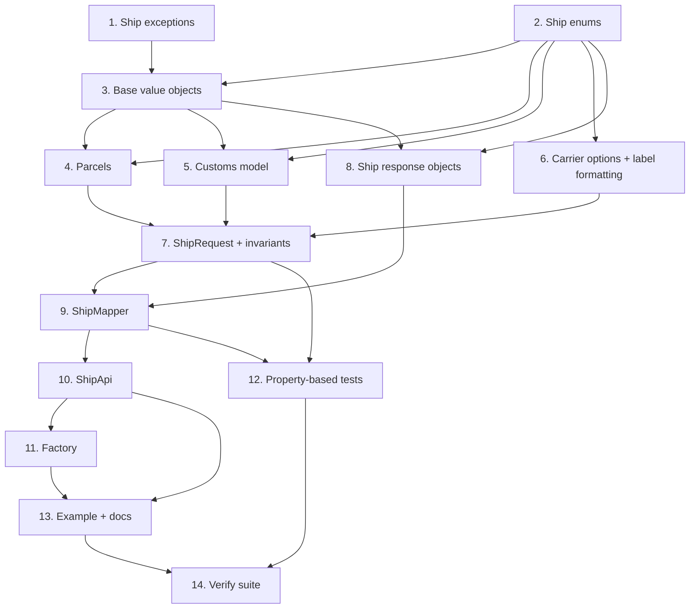

# Implementation Plan

- [x] 1. Add the Ship exception hierarchy
  - Create `InvalidCountryCodeException`, `InvalidMoneyAmountException` and `InvalidCustomsException` in `src/Exception/`, each `final` and extending `InvalidArgumentException`, matching the existing exception style
  - Add `declare(strict_types=1)` to every file
  - _Requirements: 2.4, 4.2, 12.1, 12.2, 12.3_

- [x] 2. Implement the Ship enums
  - Create backed enums `DimensionUnit` (CM/IN), `WeightUnit` (KG/LB/OZ), `CashOnDeliveryType` (0/1/2/3), `Incoterm` (DAP/DDP/EXW), `CustomInfoContentsType` (documents/gift/merchandise/returned_goods/sample/other), `NonDeliveryOption` (return/abandon), `LabelType` (PDF/ZPL) and `ShipStatus` ("1"/"2") in `src/Domain/`
  - Use the exact v1.json backing values; document the CM/KG/Cash/DAP defaults that the owning objects apply
  - Write unit tests asserting valid cases and that unknown values are rejected via `tryFrom`/`from`
  - _Requirements: 3.2, 3.3, 4.5, 6.2, 6.4, 6.8, 9.2, 17.1, 16.8_

- [x] 3. Implement the base Value Objects with tests
  - [x] 3.1 Implement `CountryCode` and `Address`
    - `CountryCode` validates an ISO 3166-1 alpha-2 code (exactly two ASCII letters), normalizes to upper-case, throws `InvalidCountryCodeException` otherwise
    - `Address` composes the validated `CountryCode` and exposes name, company, street1, street2, city, state, zip, phone, email
    - Write unit tests for valid and invalid country codes including the exception
    - _Requirements: 2.2, 2.3, 2.4, 16.6_
  - [x] 3.2 Implement the monetary Value Objects
    - `MoneyAmount` (TotalValue) stores amount + currency, permits only `.` as the decimal separator, rejects `,` with `InvalidMoneyAmountException`, and renders `"<amount> <currency>"` via `toApiString()`
    - `Insurance` stores amount + currency defaulting to `EUR` when no currency is given; `CashOnDelivery` stores amount + currency + `CashOnDeliveryType` defaulting to Cash
    - Write unit tests for formatting, the rejected comma separator, and the EUR default
    - _Requirements: 4.1, 4.2, 4.3, 4.4, 4.5, 16.6_

- [x] 4. Implement parcels with tests
  - Implement `ParcelAttributes` (parcelID, parcelType, managed `sp_ioss`), `Parcel` (length/width/height/weight + `DimensionUnit` default CM + `WeightUnit` default KG + optional package + optional attributes) and a typed `ParcelCollection`
  - Keep the parcel collection typed with no raw array exposed in the public API
  - Write unit tests covering defaults, the `sp_ioss` attribute and the collection
  - _Requirements: 3.1, 3.2, 3.3, 3.4, 3.5, 3.6, 6.9, 11.3_

- [x] 5. Implement the customs model with tests
  - Implement `Cn22Item` (Description, Weight, Quantity, UnitValue, OriginCountry as `CountryCode`, Currency, HSCode, EAN, SKU, MPN, VOC in grams) and a typed `Cn22ItemCollection`
  - Implement `Customs` holding `Incoterm` (default DAP), `BillAccountNumber`, `CustomInfoContentsType`, the `Cn22ItemCollection` and `NonDeliveryOption`
  - Document that there is no separate CN23 type and that the single container carries both CN22 and CN23/CP71 line items, and that SKU is required for EU B2C <= 150 EUR from 2026-11-01
  - Write unit tests for the customs objects and the collection
  - _Requirements: 6.1, 6.3, 6.5, 6.6, 6.7, 6.10, 6.11, 6.12, 11.3_

- [x] 6. Implement carrier options and label formatting with tests
  - Implement `CarrierOption` (name/value, any name allowed) and a typed `CarrierOptionCollection`, plus `CarrierOptionName` documented helper constants for common DHL and UPS options
  - Implement `LabelFormatting` with optional `LabelType`, `LabelWidth`/`LabelHeight` in centimetres, `Rotate`, `PageNumber` and `SplitPages`; document the 4x8 inch -> ~10.16 x 20.32 cm note
  - Write unit tests asserting arbitrary carrier option names are accepted and that label-formatting members are optional
  - _Requirements: 7.1, 7.2, 7.3, 7.4, 7.5, 13.1, 13.2, 17.1, 17.2, 17.3, 17.4, 17.5, 17.6_

- [x] 7. Implement `ShipRequest` with the customs invariants and tests
  - Implement `ShipRequest` modeling `ShipParams`: mandatory to_address, from_address, parcels, TransactionID, ContentDescription, CarrierName, CarrierService, CarrierID; optional RateID, OrderID, TotalValue, Insurance, CashOnDelivery, notes, PaymentMethod, Customs, CarrierOptions, return-label members (incl. return_to and ReturnInsurance), IsReturn, LabelFormatting and order-level Attributes
  - Enforce the three Requirement 12 invariants in the constructor: EXW requires BillAccountNumber, BillAccountNumber requires EXW, cross-border requires TotalValue; throw `InvalidCustomsException` and leave all other rules to the API
  - Provide `isCrossBorder()` comparing from/to country codes
  - Write unit tests for each invariant (valid and rejected) and a cross-border detection test
  - _Requirements: 2.1, 2.5, 2.6, 5.1, 5.2, 8.1, 8.2, 8.3, 8.4, 8.5, 11.3, 12.1, 12.2, 12.3, 12.4, 12.5_

- [x] 8. Implement the Ship response objects
  - Implement `LabelUrlCollection`, `ErrorType`, `ErrorSuggestion`, `ShipParcel`, `ShipParcelCollection`, `ShipResponseBody` (Result, ShipStatus, label urls, tracking fields, nullable DeliveryCarrier, error fields, PDF/ZPL/AdditionalTrackingNumbers, Parcels/ReturnParcels, `hasBusinessError()`) and `ShipResponse` (StatusCode + ResponseHeaders + nullable body + optional ApiError + `hasError()`)
  - Keep the response types consistent with the existing `StatusResponse` shape
  - _Requirements: 9.1, 9.2, 9.3, 9.7, 9.8, 9.9, 9.10, 10.5_

- [x] 9. Implement `ShipMapper` with tests
  - [x] 9.1 Implement request encoding
    - `encodeParams(ShipRequest)` builds the `ShipParams` array using the exact v1.json field names and omits every optional member that is absent
    - `encodeRequest(ShipRequest)` wraps it as `{"Method":"Ship","Params":<params>}` via `json_encode(..., JSON_THROW_ON_ERROR)`, matching `PingMapper`
    - Write unit tests asserting field names, omission of absent optionals and the envelope shape
    - _Requirements: 1.1, 1.2, 5.3, 7.2, 11.1, 17.7_
  - [x] 9.2 Implement response mapping and polymorphic label normalization
    - `mapResponseBody(array)` guards required fields and throws `MissingRequiredFieldsException` naming the missing ones, then maps all fields into `ShipResponseBody` incl. nested `ErrorType`/`ErrorSuggestion`/`ShipParcel` collections
    - `mapLabelUrl(array)` normalizes the polymorphic `LabelURL` (absent/empty array, single string, array of strings) into a `LabelUrlCollection`
    - Write unit tests for complete, minimal and malformed JSON, the missing-required-fields path and all three LabelURL shapes
    - _Requirements: 9.1, 9.4, 9.5, 9.6, 10.4, 11.1, 16.3, 16.4_

- [x] 10. Implement `ShipApi` with tests
  - Implement `ShipApi::ship(ShipRequest): ShipResponse` following the `StatusApi` decode/guard/map flow: encode via `ShipMapper`, send through the existing `Http\Client::postV1('/v1/Ship', ...)`, wrap the HTTP status in `StatusCode`, map headers via `HeaderMapper`, decode the body with the empty-body guard and `JSON_THROW_ON_ERROR`, map a possible `ApiError` via `ErrorMapper`, return a body-less response on non-OK/error and a mapped body on 200
  - Do not add any Ship-specific logic to `Http\Client`
  - Write `ShipApiTest` mocking/stubbing `Http\Client` per the existing style: assert the `/v1/Ship` path, the Bearer envelope body, `StatusCode` handling for 200 and each of 400/401/403/404/429/500 without throwing, the typed `ShipResponse` with headers and optional `ApiError`, and the business-error-200 path exposing status/errorMessage/errorType/errorSuggestion
  - _Requirements: 1.1, 1.3, 1.5, 10.1, 10.2, 10.3, 10.5, 11.2, 11.4, 16.2_

- [x] 11. Wire the factory and extend its test
  - Extend `ShippyProFactory` with `createShipApi(): ShipApi` and a private `createShipMapper()`, wired like `createPingApi()` reusing the existing client, header mapper and error mapper
  - Extend `ShippyProFactoryTest` to assert `createShipApi()` returns a `ShipApi`
  - _Requirements: 1.4_

- [x] 12. Implement the property-based tests for the Correctness Properties
  - Add 10 Eris property tests under `tests/Unit/Property`, each running at least 100 iterations and tagged with a comment `Feature: ship-endpoint, Property {n}: {property text}`
  - Cover: ShipParams request round-trip, LabelURL normalization across all three shapes, CountryCode validation, MoneyAmount decimal-separator invariant, Insurance default currency, CarrierOption arbitrary name, response mapper rejects missing required fields, EXW requires BillAccountNumber, BillAccountNumber requires EXW, and cross-border requires TotalValue
  - _Requirements: 16.1, 16.5, 2.3, 4.1, 4.2, 7.4, 9.4, 9.5, 9.6, 10.4, 12.1, 12.2, 12.3_

- [x] 13. Create the example and update documentation
  - Create `examples/ship.php` demonstrating an end-to-end cross-border shipment with typed `Address` objects of differing countries, a `ParcelCollection`, a `Customs` block with `Cn22Item` line items, and a DHL or UPS `CarrierOption` via the named helpers
  - Add the `examples-ship` Makefile target consistent with `examples-ping`/`examples-status`, and update `README.md` and `CHANGELOG.md` for the new Ship endpoint
  - _Requirements: 15.1, 15.2_

- [x] 14. Verify the full suite and strict quality gates
  - Run the strict PHPUnit suite with coverage and confirm 100% unit coverage of the new Ship classes with no warnings, risky tests, deprecations or notices
  - Run php-cs-fixer and confirm the new code is style-clean
  - _Requirements: 16.1, 16.7_

## Task Dependency Graph



```json
{
  "waves": [
    { "wave": 1, "tasks": ["1", "2"] },
    { "wave": 2, "tasks": ["3"] },
    { "wave": 3, "tasks": ["4", "5", "6", "8"] },
    { "wave": 4, "tasks": ["7"] },
    { "wave": 5, "tasks": ["9"] },
    { "wave": 6, "tasks": ["10", "12"] },
    { "wave": 7, "tasks": ["11"] },
    { "wave": 8, "tasks": ["13"] },
    { "wave": 9, "tasks": ["14"] }
  ]
}
```
