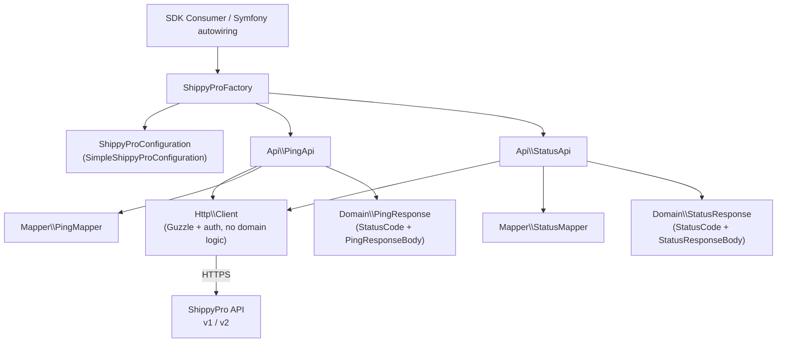
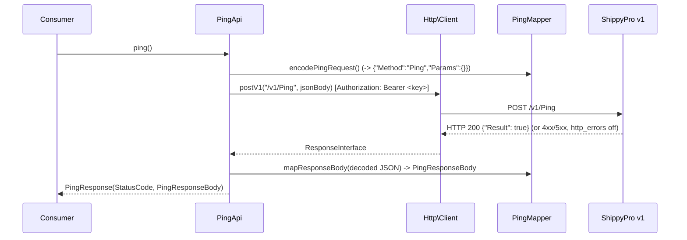
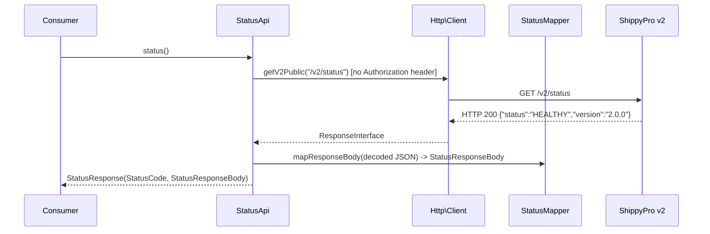

# Design Document

## Overview

This document describes the technical design of the **ShippyPro SDK (PHP)** — a typed, object-oriented PHP library that exposes the [ShippyPro API](https://api.shippypro.com/docs) as native PHP objects. The first iteration covers exactly two endpoints:

- `POST /v1/Ping` — a Bearer-authenticated connection/auth check of the v1 API.
- `GET /v2/status` — a public (unauthenticated) health check of the v2 API.

The request and response schemas are bindingly defined by the OpenAPI documents in the project root: #[[file:v1.json]] and #[[file:v2.json]]. These are the single source of truth; the design derives every field name, type and `security` decision from them. Content derived from those documents has been rephrased for compliance with licensing restrictions.

### Design Goals

- **Everything is an object.** The public API accepts and returns only Value Objects and typed domain objects. Arrays appear only inside Mappers, at the (de)serialization boundary (Requirement 8).
- **Consistency with the templates.** The SDK follows `ergosoft-sdk` for Value Object / Domain / Mapper / Exception conventions and the `{Name}Configuration` + `Simple{Name}Configuration` + `{Name}Factory` wiring, and `shipcloud-sdk` for the Factory / Api / `Http\Client` pattern with API-key authentication. `teppana/aws-sdk` informs the `examples/` and Docker layout.
- **Correct per-version transport.** v1 is an envelope-style POST (`{"Method","Params"}`) with a Bearer header; v2 `status` is a plain unauthenticated GET. A single `Http\Client` serves both cleanly.
- **Errors surface through `StatusCode`.** HTTP error codes (`400/401/403/404/429/500`) are exposed via the `StatusCode` Value Object in the response object rather than thrown, so callers inspect the result object (Requirements 2.6, 4.5, 7.3).
- **Framework-agnostic.** No Symfony bundle; integration is via autowiring documented in the `README.md` (Requirement 9).

### Key Design Decisions and Rationale

| Decision | Rationale |
| --- | --- |
| `Http\Client` disables Guzzle `http_errors` | So `4xx`/`5xx` responses return a `ResponseInterface` and surface via `StatusCode` instead of throwing `BadResponseException`, matching Requirements 2.6, 4.5, 7.3. |
| Per-version request helpers on `Http\Client` | v1 needs a Bearer header + envelope body POST; v2 `status` needs an unauthenticated GET. Keeping both behaviors in the one client (which owns Guzzle and auth) honors the "no domain logic in the client" rule (Requirement 8.1). |
| `ApiKey` injected into `Http\Client`, not individual requests | Matches `shipcloud-sdk`, where the client is constructed with the API key. The v2 `status` call simply omits the `Authorization` header regardless of the configured key. |
| `StatusCode` carries the raw int plus boolean helpers | Lets callers branch on outcomes expressively (`isTooManyRequests()` for 429, etc.) without magic numbers (Requirement 6.4). |
| Separate Mapper per endpoint | `PingMapper` and `StatusMapper` are the only places that touch arrays, keeping the serialization boundary explicit and testable (Requirement 8.3). |

## Architecture

The SDK is layered so that transport, orchestration, and (de)serialization are strictly separated (Requirement 8).



### Request Flow — `POST /v1/Ping`



### Request Flow — `GET /v2/status`



### Directory Layout

Analogous to `ergosoft-sdk` (Requirement 1.7):

```
shippy-pro-sdk/
├── examples/
│   ├── ping.php
│   └── status.php
├── src/
│   ├── Api/
│   │   ├── PingApi.php
│   │   └── StatusApi.php
│   ├── Domain/
│   │   ├── ApiKey.php
│   │   ├── BaseUrl.php
│   │   ├── PartnerName.php            (optional Referer identifier)
│   │   ├── RequestTimeout.php
│   │   ├── StatusCode.php
│   │   ├── PingResponse.php
│   │   ├── PingResponseBody.php
│   │   ├── StatusResponse.php
│   │   └── StatusResponseBody.php
│   ├── Exception/
│   │   ├── InvalidApiKeyException.php
│   │   ├── InvalidBaseUrlException.php
│   │   ├── InvalidPartnerNameException.php
│   │   ├── InvalidRequestTimeoutException.php
│   │   └── MissingRequiredFieldsException.php
│   ├── Http/
│   │   └── Client.php
│   ├── Mapper/
│   │   ├── PingMapper.php
│   │   └── StatusMapper.php
│   ├── ShippyProConfiguration.php
│   ├── SimpleShippyProConfiguration.php
│   └── ShippyProFactory.php
├── tests/
│   ├── Unit/
│   └── Integration/
├── .php-cs-fixer.php
├── composer.json
├── docker-compose.yml
├── Makefile
├── phpunit.xml.dist
├── README.md
├── CHANGELOG.md
├── CONTRIBUTING.md
└── LICENSE
```

### Technical Constraints (Requirement 1)

- PHP `>=8.5`, minimum patch level `8.5.12`; `declare(strict_types=1)` in every source file.
- Guzzle (`guzzlehttp/guzzle`) as the HTTP client.
- PSR-4 autoloading under `DjThossi\ShippyProSdk\`.
- MIT license.
- `docker-compose.yml` using `ronisaha/php-8-debian:cli-8.5.12` (Composer + Xdebug preinstalled).
- **Platform note:** the published tags of `ronisaha/php-8-debian:cli-8.5.12` currently cover only `linux/amd64`; on `arm64` (Apple Silicon) the image runs under emulation. This is documented in the `README.md` (Requirement 1.8).

## Components and Interfaces

### `Http\Client` (Requirements 2, 8.1)

Encapsulates Guzzle and authentication. Contains **no domain logic** — it speaks HTTP and knows nothing about Ping or status semantics. It is constructed from the resolved configuration Value Objects.

Key design points:
- Guzzle is configured with `http_errors => false` so that `4xx`/`5xx` responses are returned as a `ResponseInterface` and can be inspected via `StatusCode`, rather than throwing. Transport-level failures (DNS, connection, timeout) still raise Guzzle `ConnectException`/`RequestException`, which are **not** swallowed — they propagate to the caller, consistent with the templates.
- The `ApiKey` is held by the client; v1 requests attach `Authorization: Bearer <api-key>`, the v2 public GET omits it.
- An optional `PartnerName` (if configured) is sent as a lowercase `Referer` header on every request (Requirement 2.5).

```php
namespace DjThossi\ShippyProSdk\Http;

class Client
{
    public function __construct(
        BaseUrl $baseUrl,
        ApiKey $apiKey,
        RequestTimeout $requestTimeout,
        ?PartnerName $partnerName = null,
    );

    // v1 envelope POST, Bearer-authenticated. $jsonBody is the serialized
    // {"Method":"...","Params":{...}} envelope produced by the Mapper.
    public function postV1(string $endpoint, string $jsonBody): ResponseInterface;

    // v2 public GET, no Authorization header.
    public function getV2Public(string $endpoint): ResponseInterface;
}
```

Rationale for two explicit methods rather than a generic `execute()`: the two endpoints differ precisely in authentication and HTTP verb, and naming the two transport modes keeps the auth decision in one obvious place while still leaving the client free of domain logic.

### `Api\PingApi` (Requirement 4)

Orchestrates the `POST /v1/Ping` call: asks `PingMapper` to build the request envelope, sends it through `Http\Client::postV1`, wraps the HTTP status in a `StatusCode`, and maps the decoded body into a `PingResponseBody`.

```php
readonly class PingApi
{
    private const string ENDPOINT = '/v1/Ping';
    private const string METHOD = 'Ping';

    public function __construct(private Client $client, private PingMapper $mapper) {}

    public function ping(): PingResponse;
}
```

Behavior:
- Sends `{"Method":"Ping","Params":{}}` (the `Params` object is empty with `additionalProperties: false`, per #[[file:v1.json]]).
- On `200`, returns `PingResponse(StatusCode(200), PingResponseBody(result: bool))`.
- On an error code (`400/401/403/404/429/500`), the code is exposed through `StatusCode`; the body mapping is only attempted for successful responses (an error body is not a `PingResponse` body).

### `Api\StatusApi` (Requirement 5)

Orchestrates the `GET /v2/status` call with no `Authorization` header and maps the body into a `StatusResponseBody`.

```php
readonly class StatusApi
{
    private const string ENDPOINT = '/v2/status';

    public function __construct(private Client $client, private StatusMapper $mapper) {}

    public function status(): StatusResponse;
}
```

### `ShippyProConfiguration` (interface) and `SimpleShippyProConfiguration` (Requirement 3)

```php
interface ShippyProConfiguration
{
    public function getApiKey(): ApiKey;
    public function getBaseUrl(): BaseUrl;            // default https://api.shippypro.com
    public function getRequestTimeout(): RequestTimeout; // default 10 seconds
    public function getPartnerName(): ?PartnerName;   // optional Referer identifier
}

final readonly class SimpleShippyProConfiguration implements ShippyProConfiguration
{
    // Only ApiKey is mandatory; BaseUrl, RequestTimeout and PartnerName default.
    public function __construct(
        ApiKey $apiKey,
        ?BaseUrl $baseUrl = null,
        ?RequestTimeout $requestTimeout = null,
        ?PartnerName $partnerName = null,
    );
}
```

Defaults are filled in the constructor exactly as `SimpleErgosoftConfiguration` does: `BaseUrl('https://api.shippypro.com')` and `RequestTimeout(10)` when not supplied.

### `ShippyProFactory` (Requirement 3.3)

Wires the client, mappers and Api classes, following `ErgosoftFactory`'s `create*Api()` + private `createClient()` shape.

```php
readonly class ShippyProFactory
{
    public function __construct(private ShippyProConfiguration $configuration) {}

    public function createPingApi(): PingApi;
    public function createStatusApi(): StatusApi;

    private function createClient(): Client;          // from configuration
    private function createPingMapper(): PingMapper;
    private function createStatusMapper(): StatusMapper;
}
```

### Mappers (Requirement 8.3)

`PingMapper` and `StatusMapper` are the only classes allowed to touch arrays, and only at the JSON boundary.

```php
readonly class PingMapper
{
    public const string FIELD_RESULT = 'Result'; // JSON field per v1.json

    public function encodeRequest(): string;                 // -> {"Method":"Ping","Params":{}}
    public function mapResponseBody(array $data): PingResponseBody;
}

readonly class StatusMapper
{
    public const string FIELD_STATUS = 'status';
    public const string FIELD_VERSION = 'version';
    public const array REQUIRED_FIELDS = [self::FIELD_STATUS, self::FIELD_VERSION];

    public function mapResponseBody(array $data): StatusResponseBody;
}
```

Both mappers validate required fields and throw `MissingRequiredFieldsException` (naming the missing fields) when a required field is absent, analogous to `JobMapper::ensureRequiredFields` (Requirement 7.2).

## Data Models

### Value Objects (Requirement 6)

All Value Objects are `final readonly` with validation in the constructor (Requirement 6.5), mirroring `ergosoft-sdk`.

| Value Object | Encapsulates | Validation | Exception |
| --- | --- | --- | --- |
| `ApiKey` | the ShippyPro API key (string) | must not be empty (after trim) | `InvalidApiKeyException` (6.1) |
| `BaseUrl` | the API base URL | non-empty, valid URL via `FILTER_VALIDATE_URL`, trailing `/` trimmed (same as `ergosoft-sdk`) | `InvalidBaseUrlException` (6.2) |
| `RequestTimeout` | timeout in seconds (int) | must be a positive number of seconds | `InvalidRequestTimeoutException` (6.3) |
| `PartnerName` | optional Referer identifier | non-empty, lowercase, consistent identifier | `InvalidPartnerNameException` |
| `StatusCode` | an HTTP status code (int) | — (wraps any int) | — |

`StatusCode` provides the helper methods required by Requirement 6.4:

```php
readonly class StatusCode
{
    public function __construct(public int $value) {}

    public function isSuccessful(): bool;     // 200–299
    public function isOk(): bool;             // 200
    public function isBadRequest(): bool;     // 400
    public function isForbidden(): bool;      // 403
    public function isNotFound(): bool;       // 404
    public function isTooManyRequests(): bool;// 429
    public function isServerError(): bool;    // 500
}
```

> Note: `RequestTimeout` in `ergosoft-sdk` accepts `>= 0`. Requirement 6.3 requires a **positive** number of seconds, so this SDK rejects `0` (and negatives) with `InvalidRequestTimeoutException`. This is an intentional, documented deviation from the template.

### Response Objects

Composite `readonly` objects following `TestCommunicationsResponse` (a `StatusCode` plus a typed body).

```php
readonly class PingResponse
{
    public function __construct(
        public StatusCode $statusCode,
        public PingResponseBody $responseBody,
    ) {}
}

readonly class PingResponseBody
{
    // Mapped from JSON field "Result"; the only field on a 200 response (Req 4.3, 4.4).
    public function __construct(public bool $result) {}
}

readonly class StatusResponse
{
    public function __construct(
        public StatusCode $statusCode,
        public StatusResponseBody $responseBody,
    ) {}
}

readonly class StatusResponseBody
{
    // status is the constant "HEALTHY"; version is e.g. "2.0.0" (Req 5.3).
    public function __construct(
        public string $status,
        public string $version,
    ) {}
}
```

### Endpoint Schemas (from the OpenAPI documents)

Derived from #[[file:v1.json]] and #[[file:v2.json]]:

**`POST /v1/Ping`** — request body `{"Method": "Ping" (const), "Params": {} }` where `PingParams` is an empty object with `additionalProperties: false`. Response `PingResponse` has a single boolean property `Result`. Documented error responses: `400`, `401`, `403`, `404`, `429`, `500`.

**`GET /v2/status`** — `security: []` (public, no `Authorization`). `200` response is an object with required `status` (string const `HEALTHY`) and required `version` (string, e.g. `"2.0.0"`).

## Correctness Properties

*A property is a characteristic or behavior that should hold true across all valid executions of a system — essentially, a formal statement about what the system should do. Properties serve as the bridge between human-readable specifications and machine-verifiable correctness guarantees.*

The following properties are derived from the prework analysis of the requirements' acceptance criteria. They focus on the pure, input-varying logic of the SDK — the Mappers (round-trips, required-field validation) and the Value Objects (validation invariants) — which is where property-based testing adds the most value. Endpoint wiring, authentication header behavior and HTTP status handling are verified with example-based unit tests and are classified under the Testing Strategy rather than as universal properties.

### Property 1: Status body round-trip

*For any* `StatusResponseBody` with a `status` and `version`, encoding it to its JSON field map and mapping that map back through `StatusMapper::mapResponseBody` SHALL produce an equivalent `StatusResponseBody`.

**Validates: Requirements 11.6, 5.3, 8.3**

### Property 2: Ping body round-trip

*For any* boolean `result`, building the JSON field map `{"Result": result}` and mapping it through `PingMapper::mapResponseBody` SHALL produce a `PingResponseBody` whose `result` equals the original boolean.

**Validates: Requirements 11.6, 4.3, 8.3**

### Property 3: Mapper rejects missing required fields

*For any* input map that omits at least one required field of a response body, the corresponding Mapper SHALL throw `MissingRequiredFieldsException` naming exactly the omitted required field(s).

**Validates: Requirements 7.2, 11.5**

### Property 4: `ApiKey` rejects empty values

*For any* string that is empty or whitespace-only, constructing an `ApiKey` SHALL throw `InvalidApiKeyException`; *for any* non-empty string, construction SHALL succeed and preserve the value.

**Validates: Requirements 6.1, 2.1**

### Property 5: `BaseUrl` validation invariant

*For any* string that is not a valid URL, constructing a `BaseUrl` SHALL throw `InvalidBaseUrlException`; *for any* valid URL, construction SHALL succeed and the stored value SHALL carry no trailing slash.

**Validates: Requirements 6.2**

### Property 6: `RequestTimeout` accepts only positive seconds

*For any* integer `n <= 0`, constructing a `RequestTimeout` SHALL throw `InvalidRequestTimeoutException`; *for any* integer `n > 0`, construction SHALL succeed and preserve `n`.

**Validates: Requirements 6.3**

### Property 7: `StatusCode` helper classification

*For any* HTTP status code integer, exactly the matching `StatusCode` helper SHALL report true for the codes it names (200 → `isOk`, 400 → `isBadRequest`, 403 → `isForbidden`, 404 → `isNotFound`, 429 → `isTooManyRequests`, 500 → `isServerError`), and `isSuccessful` SHALL be true exactly for codes in the range 200–299.

**Validates: Requirements 6.4, 2.6, 4.5, 7.3**

## Error Handling

The SDK distinguishes three error categories:

1. **Value Object validation failures.** Constructing a Value Object with an invalid value throws a dedicated, expressive exception from `src/Exception/` (`InvalidApiKeyException`, `InvalidBaseUrlException`, `InvalidRequestTimeoutException`, `InvalidPartnerNameException`). These extend `InvalidArgumentException`, matching `ergosoft-sdk` (Requirement 7.1).

2. **Mapping failures.** When a required field is missing from a response body, the Mapper throws `MissingRequiredFieldsException`, which names the missing fields in its message (Requirement 7.2), reusing the `ergosoft-sdk` pattern.

3. **HTTP error responses.** Because `Http\Client` sets Guzzle `http_errors => false`, documented API error codes (`400/401/403/404/429/500`, including `429 Too Many Requests` from the 20-calls-per-10-seconds rate limit) are **not** thrown. They are returned as a `ResponseInterface` and surfaced to the caller through the `StatusCode` on the response object (Requirements 2.6, 4.5, 7.3). Callers branch using the `StatusCode` helpers.

   Transport-level failures (connection refused, DNS, timeout) are genuinely exceptional and are **not** swallowed: Guzzle's `ConnectException` / `RequestException` propagate to the caller. The SDK does not catch and hide them, consistent with the templates.

Rate limiting itself is **not** implemented in this iteration; the 20-calls-per-10-seconds limit is documented in the `README.md`, and a `429` is simply observable via `StatusCode::isTooManyRequests()` (Requirements 2.6, 13.4).

## Testing Strategy

### Property-Based Testing Applicability

PBT **is** appropriate for the pure logic of this SDK: the Mappers are serializers/deserializers (ideal round-trip candidates) and the Value Objects have clear input→validation behavior over a large input space. These are covered by the Correctness Properties above.

PBT is **not** used for: endpoint wiring, the authentication-header decision, HTTP verb/path selection, and status-code handling of concrete responses. These do not vary meaningfully across 100 random inputs and are better served by example-based unit tests that mock `Http\Client` (the `TestCommunicationsApiTest` style). There is no external I/O under test in the unit suite — the client is always mocked.

### Tooling and Libraries

- **Test framework:** PHPUnit `^11.x` (matching the templates), configured in `phpunit.xml.dist` with `failOnWarning`, `failOnRisky`, `failOnDeprecation` and `failOnNotice` all enabled (Requirement 11.7), and an HTML coverage report written to `html-coverage/` (Requirement 11.2).
- **Property-based testing library:** a PHP PBT library (e.g. a QuickCheck-style library for PHP) is used — PBT is **not** implemented from scratch. Each property test runs a **minimum of 100 iterations**. Each test is tagged with a comment referencing its design property, using the format:

  `Feature: shippy-pro-sdk, Property {number}: {property_text}`

### Unit Tests (`tests/Unit`)

- **Api tests** (`PingApiTest`, `StatusApiTest`): mock `Http\Client` and verify, per `TestCommunicationsApiTest`:
  - the correct endpoint path (`/v1/Ping`, `/v2/status`),
  - authentication behavior — `PingApi` goes through `postV1` (Bearer envelope POST with body `{"Method":"Ping","Params":{}}`), `StatusApi` goes through `getV2Public` (no `Authorization` header),
  - status-code handling for `200` and each documented error (`400/401/403/404/429/500` for Ping; `200` for status), asserting the matching `StatusCode` helper,
  - mapping of the response body into the typed response object.
- **Value Object tests**: cover valid and invalid inputs, including that each invalid input raises the correct exception (Requirement 11.4). Boundary cases (empty/whitespace `ApiKey`, non-URL `BaseUrl`, zero/negative `RequestTimeout`) are explicit examples complementing the property tests.
- **Mapper tests**: cover complete, minimal and malformed JSON inputs (Requirement 11.5), including the `MissingRequiredFieldsException` path and the round-trip property (Requirement 11.6).
- **Configuration test**: `SimpleShippyProConfigurationTest` verifies defaults (base URL, 10-second timeout) and that only `ApiKey` is mandatory.

**Coverage goal:** 100% unit coverage of `src/`, measured by the PHPUnit coverage report (Requirement 11.1).

### Integration Tests (`tests/Integration`)

A small number of smoke/integration tests may exercise the real endpoints (`GET /v2/status` is public and safe to hit; `POST /v1/Ping` needs a real key). These are kept minimal and are not part of the unit coverage target.

### Symfony Integration (Requirement 9)

The SDK is framework-agnostic with no bundle. The `README.md` documents `services.yaml` autowiring (analogous to `ergosoft-sdk`): parameters for the API key and base URL, and autowiring of the `Http\` and `Api\` namespaces, binding `$apiKey`/`$baseUrl` into `Http\Client` and injecting the client into the `Api\` classes.

### Examples (Requirement 10)

- `examples/ping.php` — a full Ping call using a configured `ApiKey`.
- `examples/status.php` — the v2 status call constructed without needing a real key for auth (the endpoint is public).
- Each example is runnable via its own Makefile target (`make examples-ping`, `make examples-status`), alongside the standard `setup`, `phpLatest-composer-update`, `phpLatest-test`, `phpLatest-test-fast` and `php-cs-fix` targets (Requirement 12.2).
