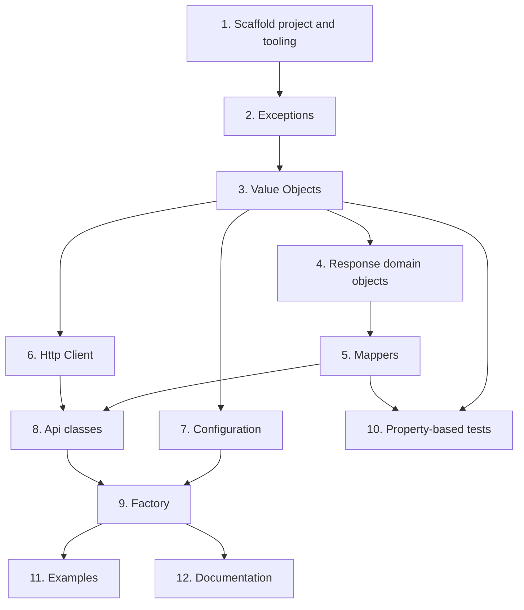

# Implementation Plan

- [x] 1. Scaffold the project structure and tooling
  - Create `composer.json` with PSR-4 autoload `DjThossi\ShippyProSdk\` -> `src/` and `DjThossi\ShippyProSdk\Tests\` -> `tests/`, `php >=8.5`, `guzzlehttp/guzzle`, `ext-json`, and require-dev `phpunit/phpunit ^11` and `friendsofphp/php-cs-fixer`, MIT license
  - Create the empty directory skeleton analogous to `ergosoft-sdk`: `examples/`, `src/Api/`, `src/Domain/`, `src/Exception/`, `src/Http/`, `src/Mapper/`, `tests/Unit/`, `tests/Integration/`
  - Create `phpunit.xml.dist` running strictly with `failOnWarning`, `failOnRisky`, `failOnDeprecation` and `failOnNotice`, covering `src/` and writing an HTML coverage report to `html-coverage/`
  - Create `.php-cs-fixer.php` matching the template rule set (`@Symfony`, `@Symfony:risky`, `declare_strict_types`, `global_namespace_import` and related rules)
  - Create `docker-compose.yml` using the image `ronisaha/php-8-debian:cli-8.5.12` (Composer + Xdebug preinstalled)
  - Create a `Makefile` with the targets `setup`, `phpLatest-composer-update`, `phpLatest-test`, `phpLatest-test-fast`, `php-cs-fix`, `examples-ping` and `examples-status`
  - Create `.gitignore`, `CHANGELOG.md`, `CONTRIBUTING.md` and a MIT `LICENSE` analogous to the templates
  - _Requirements: 1.1, 1.2, 1.3, 1.4, 1.5, 1.6, 1.7, 5.1, 11.1, 11.2, 11.7, 12.1, 12.2, 12.3_

- [x] 2. Implement the exception hierarchy
  - Create `InvalidApiKeyException`, `InvalidBaseUrlException`, `InvalidRequestTimeoutException` and `InvalidPartnerNameException` in `src/Exception/`, extending `InvalidArgumentException` analogous to `ergosoft-sdk`
  - Create `MissingRequiredFieldsException` in `src/Exception/` that names the missing fields in its message
  - Add `declare(strict_types=1)` to every file
  - _Requirements: 7.1, 7.2, 1.4_

- [x] 3. Implement the Value Objects with tests
  - [x] 3.1 Implement the `ApiKey`, `BaseUrl`, `RequestTimeout` and `PartnerName` Value Objects
    - Implement each as `final readonly` with validation in the constructor
    - `ApiKey` rejects empty/whitespace values with `InvalidApiKeyException`
    - `BaseUrl` validates via `FILTER_VALIDATE_URL` (like `ergosoft-sdk`) and trims a trailing slash, throwing `InvalidBaseUrlException` on invalid input
    - `RequestTimeout` accepts only a positive number of seconds, throwing `InvalidRequestTimeoutException` for `<= 0`
    - `PartnerName` holds a non-empty lowercase Referer identifier, throwing `InvalidPartnerNameException` on invalid input
    - _Requirements: 2.1, 6.1, 6.2, 6.3, 6.5, 2.5_
  - [x] 3.2 Implement the `StatusCode` Value Object
    - Implement `final readonly` `StatusCode` wrapping an HTTP status int with helpers `isSuccessful`, `isOk`, `isBadRequest`, `isForbidden`, `isNotFound`, `isTooManyRequests` and `isServerError`
    - _Requirements: 6.4, 6.5, 2.6, 4.5, 7.3_
  - [x] 3.3 Write unit tests for the Value Objects
    - Cover valid and invalid inputs for `ApiKey`, `BaseUrl`, `RequestTimeout` and `PartnerName`, asserting the correct exception for each invalid case including boundary cases (empty/whitespace key, non-URL base url, zero/negative timeout)
    - Cover `StatusCode` helper classification for `200/400/403/404/429/500` and the `200-299` success range
    - _Requirements: 11.4, 6.1, 6.2, 6.3, 6.4_

- [x] 4. Implement the response domain objects
  - Create `final readonly` `PingResponseBody` with a typed boolean `result` field and `PingResponse` composing a `StatusCode` and a `PingResponseBody`
  - Create `final readonly` `StatusResponseBody` with required typed string fields `status` (const `HEALTHY`) and `version`, and `StatusResponse` composing a `StatusCode` and a `StatusResponseBody`
  - _Requirements: 4.2, 4.3, 4.4, 5.2, 5.3, 8.4_

- [x] 5. Implement the Mappers with tests
  - [x] 5.1 Implement `PingMapper` and `StatusMapper`
    - `PingMapper::encodeRequest()` produces the JSON envelope `{"Method":"Ping","Params":{}}` and `mapResponseBody()` maps the JSON field `Result` into a `PingResponseBody`
    - `StatusMapper::mapResponseBody()` maps required fields `status` and `version` into a `StatusResponseBody`, throwing `MissingRequiredFieldsException` naming any missing field
    - Keep Mappers as the only classes that touch arrays, at the JSON boundary
    - _Requirements: 4.1, 4.3, 5.3, 7.2, 8.3_
  - [x] 5.2 Write unit tests for the Mappers
    - Cover complete, minimal and malformed JSON inputs, including the `MissingRequiredFieldsException` path naming missing fields
    - Cover the request envelope encoding and the body round-trip
    - _Requirements: 11.5, 11.6, 7.2_

- [x] 6. Implement the Http\Client with tests
  - Implement `Http\Client` wrapping Guzzle with `http_errors => false`, constructed from `BaseUrl`, `ApiKey`, `RequestTimeout` and an optional `PartnerName`, containing no domain logic
  - Implement `postV1()` sending a Bearer-authenticated POST with the serialized envelope body, and `getV2Public()` sending an unauthenticated GET without an `Authorization` header
  - Attach an optional lowercase `Referer: <partner-name>` header when a `PartnerName` is configured
  - Write unit tests covering the auth header behavior, verb/path and the `http_errors => false` behavior using a mocked Guzzle handler
  - _Requirements: 2.2, 2.3, 2.4, 2.5, 2.6, 8.1_

- [x] 7. Implement configuration with tests
  - Define the `ShippyProConfiguration` interface with `getApiKey(): ApiKey`, `getBaseUrl(): BaseUrl`, `getRequestTimeout(): RequestTimeout` and `getPartnerName(): ?PartnerName`
  - Implement `final readonly` `SimpleShippyProConfiguration` where only the `ApiKey` is mandatory and base URL defaults to `https://api.shippypro.com` and timeout defaults to 10 seconds
  - Write `SimpleShippyProConfigurationTest` verifying the defaults and that only `ApiKey` is mandatory
  - _Requirements: 3.1, 3.2, 11.4_

- [x] 8. Implement the Api classes with tests
  - [x] 8.1 Implement `PingApi` and `StatusApi`
    - `PingApi::ping()` builds the envelope via `PingMapper`, sends it through `Client::postV1('/v1/Ping', ...)`, wraps the HTTP status in a `StatusCode` and maps the body into a `PingResponse`; the error codes `400/401/403/404/429/500` are surfaced through the `StatusCode`
    - `StatusApi::status()` sends `Client::getV2Public('/v2/status')` and maps the body into a `StatusResponse`
    - _Requirements: 4.1, 4.2, 4.5, 5.1, 5.2, 8.2_
  - [x] 8.2 Write `PingApiTest` and `StatusApiTest` mocking Http\Client
    - Mock `Http\Client` per the `TestCommunicationsApiTest` style and verify the endpoint path, authentication behavior (envelope Bearer POST vs unauthenticated GET), status-code handling for `200` and each documented error (`400/401/403/404/429/500` for Ping, `200` for status) and the body mapping
    - _Requirements: 11.3, 4.5, 2.3, 2.6_

- [x] 9. Implement the ShippyProFactory
  - Implement `final readonly` `ShippyProFactory` constructed from a `ShippyProConfiguration`, exposing `createPingApi(): PingApi` and `createStatusApi(): StatusApi` and wiring the `Http\Client` and the mappers internally via private helpers
  - Write a unit test that the factory produces working `PingApi` and `StatusApi` instances
  - _Requirements: 3.3, 8.2_

- [x] 10. Implement the property-based tests for the Correctness Properties
  - Add a PHP property-based testing dev dependency to `composer.json`
  - Implement all 7 Correctness Properties from the design (status body round-trip, ping body round-trip, Mapper rejects missing required fields, `ApiKey` rejects empty values, `BaseUrl` validation invariant, `RequestTimeout` positive-seconds invariant, `StatusCode` helper classification), each running a minimum of 100 iterations and tagged with a comment `Feature: shippy-pro-sdk, Property {n}: {property text}`
  - _Requirements: 11.6, 4.3, 5.3, 7.2, 6.1, 6.2, 6.3, 6.4, 8.3_

- [x] 11. Create the runnable examples
  - Create `examples/ping.php` demonstrating a full Ping call end-to-end using a configured `ApiKey`
  - Create `examples/status.php` demonstrating the public v2 status call constructed without a real API key
  - Ensure both are runnable via the `make examples-ping` and `make examples-status` Makefile targets
  - _Requirements: 10.1, 10.2, 10.3_

- [x] 12. Write the README and remaining documentation
  - Write `README.md` documenting Symfony `services.yaml` autowiring (parameters for API key and base URL, autowiring of the `Http\` and `Api\` namespaces)
  - Document the Apple-Silicon emulation note for `ronisaha/php-8-debian:cli-8.5.12` (currently `linux/amd64` only), and the non-goals (no Symfony bundle, no async/parallel requests, no built-in rate limiting with the documented 20-calls-per-10-seconds limit)
  - _Requirements: 9.1, 9.2, 1.8, 13.2, 13.3, 13.4_

## Task Dependency Graph



```json
{
  "waves": [
    { "wave": 1, "tasks": ["1"] },
    { "wave": 2, "tasks": ["2"] },
    { "wave": 3, "tasks": ["3"] },
    { "wave": 4, "tasks": ["4", "6", "7"] },
    { "wave": 5, "tasks": ["5"] },
    { "wave": 6, "tasks": ["8", "10"] },
    { "wave": 7, "tasks": ["9"] },
    { "wave": 8, "tasks": ["11", "12"] }
  ]
}
```
